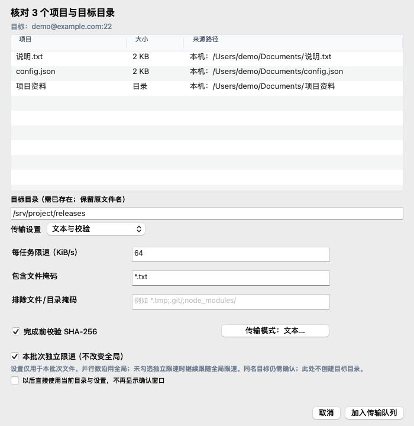
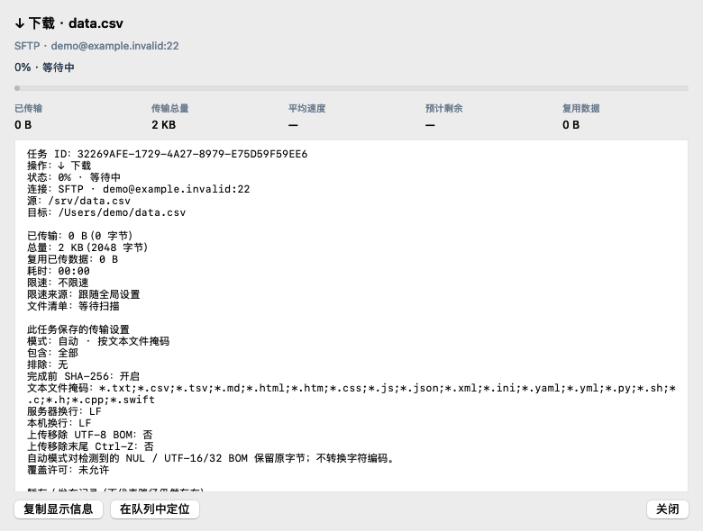

<p align="center"></p>
<h1 align="center">MacSCP</h1>
<p align="center">A native macOS dual-pane file transfer client · macOS 双栏文件传输客户端</p>

MacSCP 参考 Commander 双栏文件管理的操作方式，使用 Swift / AppKit 实现。支持 SFTP、FTP 和显式／隐式 FTPS，提供本地／远程文件管理、多会话和后台队列。

## 功能

- 登录表单、独立服务器会话与可选系统钥匙串保存密码。
- 双栏目录、可点击路径、目录树、筛选、排序、多选和文件右键操作。
- 文件／目录上传下载、跨服务器经本机中转、文件复制粘贴。
- 向文件夹、目录树或可写会话标签拖放；标签投放保留当前会话界面。
- 传输前确认、覆盖处理、进度与限速、暂停、取消、失败重试和普通队列恢复。
- 文本／二进制传输、文件规则、命名预设和导入部分 WinSCP INI 设置。
- 同步预览、镜像、可选清理、时间戳同步及保持远程更新。
- 文本编辑、文件属性、权限、校验和及远程查找。

## 界面预览

以下截图展示应用原生界面，使用示例数据。

### 双栏文件管理与后台队列


### 传输前确认与本批次设置

核对来源与目标目录，选择规则、校验和及独立限速，再加入队列。



### 队列任务详情

查看任务端点、模式、进度、限速来源与错误信息。



## 构建与运行

最低部署目标为 macOS 13。构建需要 Apple Command Line Tools（`xcode-select --install`）和 Node.js / npm，默认使用本机架构。

```sh
npm ci --ignore-scripts
./build-macscp.sh
open build/候选.noindex/MacSCP-Next.app
```

构建时通过 npm 获取 xterm.js 并打包进应用。构建使用本机临时签名。

## 使用

打开后填写主机、用户名、端口与协议；SFTP 默认端口 22。FTP 默认只读，明确允许非原子写入后才能上传。FTPS 验证服务器证书。左栏为本地，右栏为服务器；双击目录进入，点击路径段返回。F5 上传／下载，F7 新建目录，F8 删除，F9 属性；Command+C / V 复制粘贴文件，Command+Shift+C 复制路径。

## 验证

```sh
./MacSCP/check.sh
```

检查脚本编译生产模块并运行 103 组检查，包括本机 stdio SFTP、隐藏原生窗口与临时目录。完整检查需要 macOS 图形登录会话。仅编译模块可运行以下命令。

```sh
MACSCP_CHECK_COMPILE_ONLY=1 ./MacSCP/check.sh
```

更多集成脚本位于 `MacSCP/`。FTP／FTPS 测试需要 Python 测试服务依赖，SSH 网络测试使用本机回环服务。

## 许可与贡献

本项目按 GPL-3.0-only 发布，见 [LICENSE](LICENSE)。第三方组件保留各自许可，见 [THIRD_PARTY_NOTICES.md](THIRD_PARTY_NOTICES.md)。

欢迎提交可复现的问题和改进。
